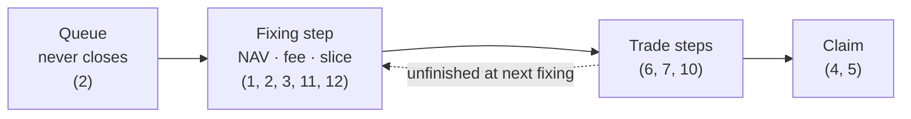

# AGENTS.md

Guidance for AI coding agents (and human contributors) working on this repository. Read this before changing anything. Money logic bugs in this project can lock or drain user funds, so the rules below are strict on purpose.

## Project in one paragraph

`tide` is a Solana (Anchor) program for a pooled BTC fund. Users queue USDC subscriptions and share redemptions; at 01:00 UTC each day the fixing price is recorded, compared with the 50-day moving average, and used to fix that epoch's NAV. Settlement then nets subscriptions against redemptions and rebalances the fund toward all-cbBTC (above the average) or all-USDC (below) through capped trades. Users then `claim` their shares or USDC. It is a **devnet prototype**: oracle and exchange are mocks.

**Design in transition.** The target design is recorded in `CONTEXT.md` (vocabulary) and `docs/adr/0001`–`0004` (decisions). The invariants below describe that target design. Until the migration lands, the code still runs the original single-instruction `settle`. Treat any difference between that code and these invariants as migration work to do, not as a rule to restore.

## Architecture

```
fund-logic/            ← ALL accounting. Pure Rust, no dependencies, fully unit-tested.
programs/tide/         ← Thin Anchor wrapper: validates accounts, moves tokens, calls fund-logic.
tests/                 ← End-to-end tests (TypeScript, bankrun with clock control).
scripts/crank.ts       ← Daily settlement script (devnet).
```

**Rule: arithmetic about money belongs in `fund-logic`, never in the Anchor program.** The program may only:
- convert between Anchor account structs and `fund_logic` structs,
- perform CPIs (transfer, mint, burn) for amounts that `fund-logic` returned,
- check things `fund-logic` cannot see (signers, PDAs, oracle staleness, mint decimals).

If you need new math, add a function to `fund-logic`, test it there, then call it from the program.

## Commands

| Task | Command | Needs Solana toolchain |
|---|---|---|
| Logic tests | `cd fund-logic && cargo test` | No |
| Format | `rustfmt --edition 2021 fund-logic/src/lib.rs programs/tide/src/lib.rs` | No |
| Sync program ID | `anchor keys sync` | Yes |
| Build | `anchor build` | Yes |
| End-to-end tests | `yarn install && anchor test` | Yes |

`fund-logic` is its own Cargo workspace (empty `[workspace]` in its `Cargo.toml`) so it builds and tests offline without Anchor. Do not add it back to the root workspace members.

Before finishing any change: `cd fund-logic && cargo test` must pass. If you touched the program, `anchor build` and `anchor test` must pass too. If you cannot run them in your environment, say so explicitly in your summary.

## Invariants — never break these

Use the terms defined in `CONTEXT.md`. Where each invariant applies:



1. **Forward pricing.** Subscriptions and redemptions are only filled inside a settlement, against the NAV fixed at the fixing time that closes their epoch, after the performance fee has been accrued. Never fill against a NAV that was public before the request was submitted. Each part of a subscription becomes shares at the valuation price and NAV of the fixing time of the settlement in which it is filled. A redemption receives what its redemption slice actually sells for (ADR 0002).
2. **Fixed pricing time.** NAV, the moving average and the signal use fixing prices published in `[fix_time, fix_time + FIX_WINDOW_SECS)`, never the price when an instruction is called. A request submitted after a fixing time belongs to the next epoch, so the queue never closes. A request can be cancelled until the fixing time that closes its epoch; a pending subscription can be cancelled at any time.
3. **Internal accounting.** NAV uses `FundState.usdc`, `FundState.btc` and `FundState.share_supply`. Never derive NAV from token-account balances (prevents donation/inflation attacks). Redemption slices and pending subscriptions are tracked separately and are not fund assets.
4. **Exact claims.** `claim` uses `take_pro_rata`, which gives the last claimant the exact remainder. After all tickets of an epoch are claimed, `unclaimed_*` fields are zero and the sum of claims equals the epoch totals. Redemptions become claimable only once that epoch's redemption slice is fully sold.
5. **Share supply.** `FundState.share_supply` must always equal (shares held by users, including the manager) + (shares queued for redemption). Tests assert this exactly.
6. **No stuck states.** A settlement must never fail permanently. Work left at the next fixing time carries into the next settlement. Unsold redemption slices keep selling first, and pending subscriptions stay the user's until filled or cancelled. A depeg blocks buying cbBTC, never selling it or settling.
7. **Trade guards.** Every trade:
   - is at most the trade cap in USDC notional;
   - comes at least `min_trade_interval_secs` after the previous trade;
   - passes a depeg check;
   - passes `min_out` derived from the valuation price at the moment it executes.
   The keeper uses `max_slippage_bps`. After the keeper window, other callers get a tighter bound. A fill below `min_out` reverts that trade. Trades are not compared with the fixing price (ADR 0001).
8. **Integer math only.** No floats in `fund-logic` or the program. Use `u128` intermediates and checked arithmetic; round in favor of the fund (down for amounts paid out, up for amounts the fund must sell to cover a payout).
9. **One settlement per epoch,** opened at its fixing time. Only the keeper may drive it during the keeper window; after that, anyone may.
10. **Step atomicity.** Settlement is several instructions (ADR 0001). Within each instruction, all token movements and checks happen together, so a failure rolls that step back. The state between steps must always let the next step resume.
11. **Two price feeds.** The signal and moving average use Pyth BTC/USD; NAV, `min_out` and the depeg check use Pyth cbBTC/USD (ADR 0003). A missed day's fixing price may be backfilled only with a Pyth update published in that day's fixing window.
12. **Performance fee.** Accrued at the fixing time before any fills, only on NAV above the high-water mark, which never resets. It is paid as new shares to the fee address fixed at `initialize`. The rate is capped at 20% in code (ADR 0004).

## Keeping the two layers in sync

These are easy to break when editing:

- `StateData` (program) mirrors `fund_logic::FundState` field-for-field. Update `from_logic` / `to_logic` together.
- `StateData.prices` is `[u64; 64]` as a **literal** (the IDL needs it). It must equal `fund_logic::MAX_WINDOW`; a compile-time assertion enforces this.
- `EpochRecord` (program) mirrors `fund_logic::EpochRecord`, including the four `unclaimed_*` fields. Update `set_from_logic`, `set_unclaimed`, and `to_logic`.
- Every `fund_logic::FundError` variant needs a matching `FundErrorCode` and an arm in `map_err`. The match is exhaustive, so the compiler will remind you.
- `ConfigData` has one extra field (`max_staleness_secs`) that is checked in the program, not in `fund-logic`.

## Units

| Quantity | Representation |
|---|---|
| USDC | `u64`, 6 decimals |
| BTC (wrapped) | `u64`, 8 decimals |
| Shares | `u64`, 6 decimals; initial NAV is 1 share = 1 USDC |
| Price | `u64`, micro-USD per 1 BTC |
| NAV | `u128`, USDC base units per share base unit × `NAV_SCALE` (10¹²) |
| Basis points | `u16`, out of 10,000 |

`initialize` enforces USDC = 6 decimals and BTC = 8 decimals. Don't relax this without updating every conversion.

## PDA seeds

| Account | Seeds |
|---|---|
| Fund | `"fund", admin` |
| Share mint | `"share_mint", fund` |
| Vaults | `"usdc_vault" / "btc_vault" / "subscription_escrow" / "share_escrow" / "payout_vault", fund` |
| Ticket | `"ticket", fund, user` |
| Epoch record | `"epoch", fund, epoch.to_le_bytes()` |
| Mock oracle / market | `"oracle", authority` / `"market", authority` |
| Market vaults | `"market_usdc" / "market_btc", market` |

Changing seeds breaks existing deployments and the tests/scripts that derive these addresses. Update `tests/tide.ts` and `scripts/crank.ts` in the same change.

## Testing expectations

- **Every behavior change needs a `fund-logic` test.** Prefer a focused scenario test plus coverage in the randomized simulations.
- The two randomized tests (`random_simulation_invariants`, `random_simulation_with_trading_costs_never_gets_stuck`) are the main safety net. Do not weaken their assertions to make a change pass; if one fails, the change is probably wrong.
- When fixing a bug, first add a test that reproduces it.
- End-to-end tests control time with bankrun's `setClock`; advance the slot before setting the clock so identical transactions are not deduplicated.

## Mock components

`MockOracle`, `MockMarket`, `init_mock_oracle`, `set_mock_price`, and `init_mock_market` exist only for devnet. When replacing them:

- **Oracle (Pyth):** check publish time against `max_staleness_secs`, reject wide confidence intervals, convert the exponent to micro-USD carefully.
- **Exchange (Jupiter):** compute the route off-chain, pass route accounts into `settle` (or a separate `rebalance` instruction), and keep the on-chain `min_out` check against the oracle. Never trust a price supplied by the caller.
- Remove the mock instructions from mainnet builds (e.g. behind a cargo feature).

## Security checklist for any change

- [ ] Every account is constrained (seeds, `has_one`, `address`, mint, authority).
- [ ] Only the fund PDA can move vault tokens; signer seeds are `["fund", admin, bump]`.
- [ ] No arithmetic that can overflow or underflow without a checked operation.
- [ ] No path where a user can claim twice, claim another user's ticket, or claim before settlement.
- [ ] No new instruction lets the admin take user funds. The admin cannot withdraw from vaults. The only value that goes to a non-user is the performance fee, minted as shares to the fee address fixed at `initialize` (ADR 0004).
- [ ] The admin is a multisig. Config changes (trade cap, trade interval, slippage, depeg threshold, fee rate, keeper, fee address) go through a 48-hour timelock. The only immediate admin action is pausing subscriptions; redemptions can never be paused.
- [ ] The fund cannot end up in a state where `settle` always fails.

## Things not to do

- Don't add strategy "improvements" (different windows, extra indicators, leverage, altcoins) without a backtest. The project's research found that short-term altcoin strategies lost money; the 50-day rule was chosen deliberately and its edge is modest.
- Don't add marketing language implying guaranteed or safe returns anywhere in code, docs, or UI.
- Don't deploy to mainnet or accept outside funds. That requires an audit and legal review first; flag it to the maintainer instead.
- Don't disable TLS verification or embed private keys in scripts.

## Style

- Rust: `rustfmt` defaults (edition 2021). Small pure functions in `fund-logic`; return `Result<_, FundError>`.
- Comments explain *why*, especially around rounding direction and ordering inside `settle`.
- TypeScript: keep helper functions in tests small; derive PDAs with the same seeds as the program.

## Agent skills

### Issue tracker

Issues live in GitHub Issues on `0xnex/tide`, managed with the `gh` CLI. See `docs/agents/issue-tracker.md`.

### Triage labels

Default vocabulary: `needs-triage`, `needs-info`, `ready-for-agent`, `ready-for-human`, `wontfix`. See `docs/agents/triage-labels.md`.

### Domain docs

Single-context: one `CONTEXT.md` and `docs/adr/` at the repo root. See `docs/agents/domain.md`.
