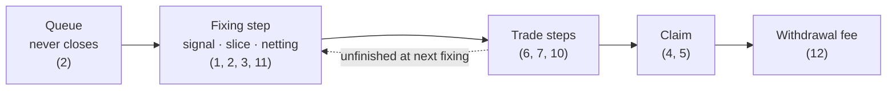

# AGENTS.md

Guidance for AI coding agents (and human contributors) working on this repository. Read this before changing anything. Money logic bugs in this project can lock or drain user funds, so the rules below are strict on purpose.

## Project in one paragraph

`tide` is a Solana (Anchor) program for a pooled BTC fund. Users queue USDC subscriptions and share redemptions; at 01:00 UTC each day the fixing price is recorded and compared with the 50-day moving average. Settlement then sets aside the redemption slice, nets subscriptions against it, and rebalances the fund toward all-cbBTC (above the average) or all-USDC (below) through capped trades. Shares follow actual execution, never a USD valuation. Users then `claim` their shares or USDC. It is a **devnet prototype**: prices come from Pyth, the exchange is a mock.

The design is recorded in `CONTEXT.md` (vocabulary) and `docs/adr/` (decisions; 0005–0007 replace parts of 0002–0004). The invariants below describe the code as it is.

## Replies

Write every reply in plain language: short sentences, one idea each. Lead with the answer, then the detail. Explain a code name (an error, a field) in everyday words the first time it appears.

## Architecture

```
fund-logic/            ← ALL accounting. Pure Rust, no dependencies, fully unit-tested.
programs/tide/         ← Thin Anchor wrapper: validates accounts, moves tokens, calls fund-logic.
tests/                 ← End-to-end tests (TypeScript, bankrun with clock control).
scripts/crank.ts       ← Daily settlement script (devnet): posts Pyth prices, fix, trades, collect_fees.
scripts/setup.ts       ← Creates a devnet fund (incl. share token metadata); scripts/faucet.ts mints mock USDC to test wallets.
app/                   ← Web frontend (Vite + React, deployed on Vercel). Own package.json; copy the IDL with `yarn sync-idl`.
app/api/faucet.ts      ← Vercel function: 10,000 mock USDC (+ a little SOL) once per address, signed by a faucet wallet (env FAUCET_SECRET_KEY) that holds the mock USDC mint authority.
.github/workflows/     ← crank.yml runs the crank daily at 01:05 UTC with secrets KEEPER_KEYPAIR and PYTH_API_KEY; it copies the IDL from app/src/idl.
```

**Rule: arithmetic about money belongs in `fund-logic`, never in the Anchor program.** The program may only:
- convert between Anchor account structs and `fund_logic` structs,
- perform CPIs (transfer, mint, burn) for amounts that `fund-logic` returned,
- check things `fund-logic` cannot see (signers, PDAs, the Pyth price account's owner / verification / feed ID, price staleness, mint decimals).

If you need new math, add a function to `fund-logic`, test it there, then call it from the program.

## Commands

| Task | Command | Needs Solana toolchain |
|---|---|---|
| Logic tests | `cd fund-logic && cargo test` | No |
| Format | `rustfmt --edition 2021 fund-logic/src/lib.rs programs/tide/src/lib.rs` | No |
| Sync program ID | `anchor keys sync` | Yes |
| Build | `anchor build` | Yes |
| End-to-end tests | `yarn install && anchor test` | Yes |

`fund-logic` is its own Cargo workspace (empty `[workspace]` in its `Cargo.toml`) so it builds and tests offline without Anchor. Do not add it back to the root workspace members.

Before finishing any change: `cd fund-logic && cargo test` must pass. If you touched the program, `anchor build` and `anchor test` must pass too. If you cannot run them in your environment, say so explicitly in your summary.

## Invariants — never break these

Use the terms defined in `CONTEXT.md`. Where each invariant applies:



1. **Execution pricing.** Subscriptions and redemptions are only filled inside the settlement opened by the fixing time that closes their epoch, and only by actual execution (ADR 0002, 0006). A redemption receives what its redemption slice actually sells for. A subscription part becomes shares = fund asset it adds × share supply ÷ the fund's holding of that asset, counted only once the fund's own rebalance is complete. The fund is never valued in USD.
2. **Fixed pricing time.** The moving average, the signal and netting use fixing prices published in `[fix_time, fix_time + FIX_WINDOW_SECS)`, never the price when an instruction is called. A request submitted after a fixing time belongs to the next epoch, so the queue never closes. A request can be cancelled until the fixing time that closes its epoch; a pending subscription can be cancelled at any time.
3. **Internal accounting.** Share issuance and redemption slices use `FundState.usdc`, `FundState.btc` and `FundState.share_supply`. Never derive them from token-account balances (prevents donation/inflation attacks). Redemption slices and pending subscriptions are tracked separately and are not fund assets.
4. **Exact claims.** The last claimant of an epoch gets the exact remainder (`take_pro_rata` for redemption USDC and refunds; the remaining `unclaimed_shares` for subscription shares, which may be claimed in parts as they fill). After all tickets of an epoch are claimed, `unclaimed_*` fields are zero and the sum of claims equals the epoch totals. Redemptions become claimable only once that epoch's redemption slice is fully sold.
5. **Share supply.** `FundState.share_supply` must always equal (shares held by users, including the manager) + (shares queued for redemption) + (shares issued to subscribers and still in the share escrow, `unclaimed_shares`). Tests assert this exactly.
6. **No stuck states.** A settlement must never fail permanently. Work left at the next fixing time carries into the next settlement. Unsold redemption slices keep selling first, and pending subscriptions stay the user's until filled or cancelled. A depeg blocks buying cbBTC, never selling it or settling.
7. **Trade guards.** Every trade:
   - is at most the trade cap in USDC notional;
   - comes at least `min_trade_interval_secs` after the previous trade;
   - passes a depeg check;
   - passes `min_out` derived from the valuation price at the moment it executes.
   The keeper uses `max_slippage_bps`. After the keeper window, other callers get a tighter bound. A fill below `min_out` reverts that trade. Trades are not compared with the fixing price (ADR 0001).
8. **Integer math only.** No floats in `fund-logic` or the program. Use `u128` intermediates and checked arithmetic; round in favor of the fund (down for amounts paid out, up for amounts the fund must sell to cover a payout).
9. **One settlement per epoch,** opened at its fixing time. Only the keeper may drive it during the keeper window; after that, anyone may.
10. **Step atomicity.** Settlement is several instructions (ADR 0001). Within each instruction, all token movements and checks happen together, so a failure rolls that step back. The state between steps must always let the next step resume.
11. **Price feeds.** One feed, named by the `signal_feed` config, drives the signal, the moving average, netting and `min_out`: BTC/USD by default, or Pyth cbBTC/USD where that feed exists (ADR 0005). It is set at `initialize` and changes only through the timelock. When the signal uses cbBTC/USD, a gap above the depeg threshold against BTC/USD blocks buys (ADR 0003), and so does a missing or stale BTC/USD reference, which never blocks sells or fixing. With only BTC/USD there is no depeg check and trades rely on the slippage bound. A missed day's fixing price may be backfilled only with a Pyth update published in that day's fixing window.
12. **Withdrawal fee.** 1% of the USDC a redeemer claims goes to the fee address, set at `initialize` and changeable only through the 48-hour timelock. `claim` only records it in `FundState.fees_owed` (the USDC stays in the payout vault) and `collect_fees` pays it out, so a problem with the fee address's token account can never block a claim. The rate is capped at 1% in code. There is no performance fee and no redemption fee (ADR 0007).

## Keeping the two layers in sync

These are easy to break when editing:

- `StateData` (program) mirrors `fund_logic::FundState` field-for-field. Update `from_logic` / `to_logic` together.
- `StateData.prices` is `[u64; 64]` and `StateData.price_days` is `[i64; 64]`, both as **literals** (the IDL needs it). They must equal `fund_logic::MAX_WINDOW`; a compile-time assertion enforces this.
- `StateData.slices` is `[SliceData; 8]` and `StateData.pending` is `[PendingData; 8]`, literals mirroring `fund_logic::Slice` and `fund_logic::Pending`; they must equal `MAX_SLICES` and `MAX_PENDING` (compile-time assertions).
- `Ticket` (program) mirrors `fund_logic::Ticket`, including `shares_claimed`.
- `EpochRecord` (program) mirrors `fund_logic::EpochRecord`, including the five `unclaimed_*` fields and the two `cancelled_*` fields. Update `set_from_logic`, `set_unclaimed`, and `to_logic`.
- Every `fund_logic::FundError` variant needs a matching `FundErrorCode` and an arm in `map_err`. The match is exhaustive, so the compiler will remind you.
- `ConfigData.signal_feed` (`SignalFeedData`) mirrors `fund_logic::SignalFeed`; map it in `to_logic`.
- `ConfigData` has extra fields checked in the program, not in `fund-logic`: `max_staleness_secs`, `keeper` (mapped to `fund_logic::Caller`), `fee_address` (where `collect_fees` sends the withdrawal fee) and the Pyth feed IDs `btc_feed_id` / `cbbtc_feed_id`.
- After changing the program's interface, run `yarn sync-idl` in `app/` so the frontend uses the new IDL.

## Units

| Quantity | Representation |
|---|---|
| USDC | `u64`, 6 decimals |
| BTC (wrapped) | `u64`, 8 decimals |
| Shares | `u64`, 6 decimals; the first subscriber gets 1 share per USDC |
| Price | `u64`, micro-USD per 1 BTC |
| Basis points | `u16`, out of 10,000 |

`initialize` enforces USDC = 6 decimals and BTC = 8 decimals. Don't relax this without updating every conversion.

## PDA seeds

| Account | Seeds |
|---|---|
| Fund | `"fund", admin` |
| Share mint | `"share_mint", fund` |
| Vaults | `"usdc_vault" / "btc_vault" / "subscription_escrow" / "share_escrow" / "payout_vault", fund` |
| Ticket | `"ticket", fund, user, epoch.to_le_bytes()` |
| Epoch record | `"epoch", fund, epoch.to_le_bytes()` |
| Mock market | `"market", authority` |
| Market vaults | `"market_usdc" / "market_btc", market` |

Changing seeds breaks existing deployments and the tests/scripts that derive these addresses. Update `tests/tide.ts` and `scripts/crank.ts` in the same change.

## Testing expectations

- **Every behavior change needs a `fund-logic` test.** Prefer a focused scenario test plus coverage in the randomized simulations.
- The two randomized tests (`random_simulation_invariants`, `random_simulation_with_trading_costs_never_gets_stuck`) are the main safety net. Do not weaken their assertions to make a change pass; if one fails, the change is probably wrong.
- When fixing a bug, first add a test that reproduces it.
- `init_share_metadata` calls the Metaplex Token Metadata program, which bankrun does not load, so it has no end-to-end test; it was checked on devnet.
- End-to-end tests control time with bankrun's `setClock`; advance the slot before setting the clock so identical transactions are not deduplicated.
- Each invariant has at least one named test. Keep this table current when you add or rename tests (`fund-logic` tests unless marked e2e):

| Invariant | Tests |
|---|---|
| 1 Execution pricing | `redemption_slice_is_paid_its_actual_proceeds_once_sold_out`, `subscription_buys_become_shares_by_the_cbbtc_they_add_and_are_claimed_in_parts`, `netting_fills_subscriptions_with_the_slice_cbbtc_at_the_fixing_price`, `subscriptions_wait_until_the_fund_finishes_its_rebalance` |
| 2 Fixed pricing time | `fix_price_must_be_published_in_fix_window`, `late_fix_uses_fix_prices_whatever_the_call_time`, `a_request_after_the_fixing_time_joins_the_next_epoch`, `requests_of_skipped_fixings_roll_into_the_next_one`, `a_request_can_be_cancelled_until_its_fixing_time`, `cancelling_a_pending_subscription_refunds_the_unfilled_part_and_keeps_filled_shares` |
| 3 Internal accounting | `unsold_slices_keep_priority_across_the_next_fixing` (unsold slice cbBTC is not a fund asset), `a_pending_cancel_refunds_the_unfilled_usdc_after_the_subscription_fee`, the token ledger check in every harness step, e2e "捐款不算基金资产" |
| 4 Exact claims | `redeemer_payouts_plus_fees_equal_the_epoch_payout_exactly`, `the_last_pending_subscriber_to_cancel_takes_everything_left`, both randomized simulations (`drain`) |
| 5 Share supply | both randomized simulations (`assert_share_supply`), e2e day 1 |
| 6 No stuck states | `random_simulation_with_trading_costs_never_gets_stuck`, `too_many_unsold_slices_delays_fixing_until_they_sell`, `depeg_blocks_buys_but_not_sells_or_fixing`, `a_missing_reference_blocks_buys_but_not_sells_or_fixing`, `dust_redemption_while_fully_in_btc_does_not_get_stuck` |
| 7 Trade guards | `rebalance_is_split_into_capped_trades_spaced_by_the_interval`, `trade_min_out_uses_the_valuation_price_at_execution`, `fill_below_min_out_reverts_that_trade_only`, `public_trades_use_the_tighter_slippage_bound` |
| 8 Integer math | `money_code_uses_integers_only`, `near_full_exit_with_costs_never_sells_the_stayers_btc`, `a_holder_who_stays_keeps_their_cbbtc_per_share_despite_other_flows` |
| 9 One settlement per epoch | `cannot_fix_before_1am_or_twice`, `only_the_keeper_drives_settlement_inside_the_keeper_window` |
| 10 Step atomicity | `fill_below_min_out_reverts_that_trade_only`, `too_many_unsold_slices_delays_fixing_until_they_sell` (a failed fix leaves the state unchanged), e2e day 2 rollback |
| 11 Price feeds | `the_moving_average_records_the_chosen_feeds_fixing_price`, `the_depeg_check_runs_only_when_both_feeds_exist`, `a_gap_then_backfill_restores_the_50_day_average`, `backfill_only_fills_a_missing_day_with_its_fixing_window_price` |
| 12 Withdrawal fee | `redeemers_pay_the_withdrawal_fee_on_gains_and_losses`, `share_claims_and_refunds_pay_no_withdrawal_fee`, `config_validation` (cap at 1%), e2e day 2 |

## Mock components

The oracle is real Pyth: `read_pyth` in the program checks the account owner (Pyth receiver), full Wormhole verification and the feed ID; `fund_logic::pyth_to_micro_usd` converts the exponent (rounding down) and rejects wide confidence intervals; `trade` also checks `max_staleness_secs`. `MockMarket`, `init_mock_market` and `set_mock_market_fee` exist only for devnet. When replacing them:

- **Exchange (Jupiter):** compute the route off-chain, pass route accounts into `trade`, and keep the on-chain `min_out` check against the oracle. Never trust a price supplied by the caller.
- Remove the mock instructions from mainnet builds (e.g. behind a cargo feature).

## Security checklist for any change

- [ ] Every account is constrained (seeds, `has_one`, `address`, mint, authority).
- [ ] Only the fund PDA can move vault tokens; signer seeds are `["fund", admin, bump]`.
- [ ] No arithmetic that can overflow or underflow without a checked operation.
- [ ] No path where a user can claim twice, claim another user's ticket, or claim before settlement.
- [ ] No new instruction lets the admin take user funds. The admin cannot withdraw from vaults. The only value that goes to a non-user is the withdrawal fee, paid in USDC to the fee address (set at `initialize`, changed only through the timelock; ADR 0007).
- [ ] The admin is a multisig. Config changes (trade cap, trade interval, slippage bounds, keeper window, depeg threshold, fee rate, keeper, fee address) go through a 48-hour timelock. The only immediate admin action is pausing subscriptions; redemptions can never be paused.
- [ ] The fund cannot end up in a state where `fix` or `trade` always fails.

## Things not to do

- Don't add strategy "improvements" (different windows, extra indicators, leverage, altcoins) without a backtest. The project's research found that short-term altcoin strategies lost money; the 50-day rule was chosen deliberately and its edge is modest.
- Don't add marketing language implying guaranteed or safe returns anywhere in code, docs, or UI.
- Don't deploy to mainnet or accept outside funds. That requires an audit and legal review first; flag it to the maintainer instead.
- Don't disable TLS verification or embed private keys in scripts.

## Style

- Rust: `rustfmt` defaults (edition 2021). Small pure functions in `fund-logic`; return `Result<_, FundError>`.
- Comments explain *why*, especially around rounding direction and ordering inside `fix` and `trade`.
- TypeScript: keep helper functions in tests small; derive PDAs with the same seeds as the program.

## Agent skills

### Issue tracker

Issues live in GitHub Issues on `0xnex/tide`, managed with the `gh` CLI. See `docs/agents/issue-tracker.md`.

### Triage labels

Default vocabulary: `needs-triage`, `needs-info`, `ready-for-agent`, `ready-for-human`, `wontfix`. See `docs/agents/triage-labels.md`.

### Domain docs

Single-context: one `CONTEXT.md` and `docs/adr/` at the repo root. See `docs/agents/domain.md`.
