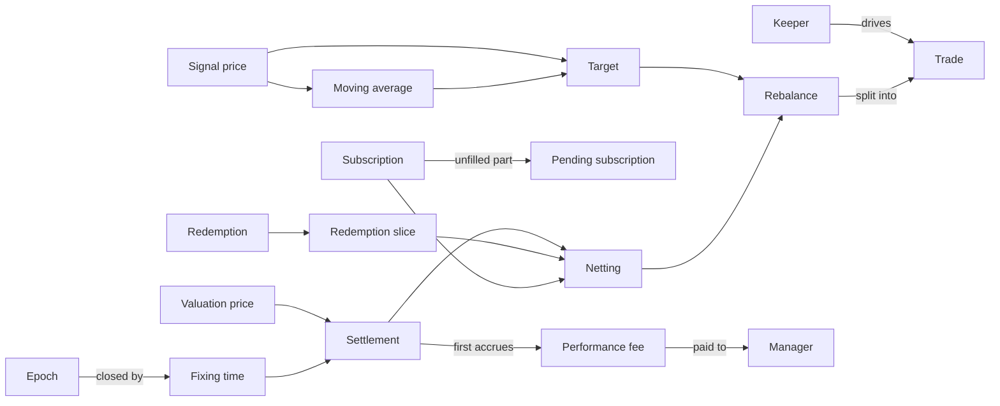

# Tide

A pooled fund on Solana that holds either cbBTC or USDC, switching once a day according to whether BTC is above or below its 50-day moving average.

## How the terms relate

## Investors

**Subscription** (申购):
A user's request to put USDC into the fund in exchange for shares; it may be filled in parts, and each part becomes shares at the valuation price and NAV of the fixing time of the settlement in which it is filled.
_Avoid_: Deposit, purchase, buy (ambiguous with the fund's own trades)

**Redemption** (赎回):
A user's request to turn shares back into USDC; the user receives what their redemption slice actually fetches, not a USDC amount fixed at the fixing time, and can claim only once that day's slice is fully sold.
_Avoid_: Withdrawal, sell

**Redemption slice** (赎回资产):
The redeemed shares' pro-rata portion of the fund's USDC and cbBTC at the fixing time, set aside for that day's redeemers and turned into USDC for them.

**Pending subscription** (待成交申购):
The part of a subscription's USDC not yet filled; it earns no shares and stays the user's until filled or cancelled. It is filled before newer subscriptions, counts toward the next epoch's subscription cap, and when the target is USDC it is filled at the next fixing time without any trade.
_Avoid_: Unfilled deposit, carry-over

**Subscription cap** (申购上限):
The maximum total USDC of subscriptions in one epoch (1M USDC), including pending subscriptions carried in; a request that would exceed it is rejected. Redemptions have no cap.

**Cancellation** (撤销):
Withdrawing a subscription or redemption before the fixing time that closes its epoch; after that, only a pending subscription can still be cancelled.

**Netting** (轧差):
Exchanging the cbBTC in the redemption slice for subscription USDC inside the fund at the valuation price, so only the difference trades on Jupiter.

## Fees

**Manager** (管理人):
The party that receives the performance fee, paid to a fee address fixed when the fund is created.
_Avoid_: Admin (the admin configures the fund; the manager is paid by it)

**Performance fee** (业绩报酬):
A share of the fund's gains above the high-water mark, paid to the manager as newly issued shares.
_Avoid_: Profit fee, carry, redemption fee

**High-water mark** (历史高点):
The highest NAV on which a performance fee has already been charged, starting at the initial NAV and never reset; no fee is charged until NAV exceeds it again.

**Subscription fee / Redemption fee** (申购费 / 赎回费):
An optional charge on each subscription or redemption that stays in the fund.

**Subscription pause** (暂停申购):
The one action the admin may take immediately: stopping new subscriptions. Redemptions can never be paused, and the admin can never move fund assets.

## Settlement

**Settlement** (结算):
The daily process that fixes the NAV and signal at the fixing time, sets aside the redemption slice, nets it against subscriptions, then rebalances until every queued subscription and redemption is complete.

**Fixing time** (定价时刻):
01:00 UTC each day; the NAV and the signal come from prices published then, whenever settlement actually runs.

**Keeper** (清算地址):
The designated address that alone may drive settlement during the keeper window.
_Avoid_: Crank, operator, admin

**Keeper window** (清算窗口):
The 30 minutes after the fixing time (01:00–01:30 UTC) when only the keeper may drive settlement; after it, anyone may, but under a tighter slippage bound than the keeper.

**Epoch** (期):
All subscriptions and redemptions submitted between two consecutive fixing times; each is priced at the fixing time that closes its epoch, so the queue never closes.
_Avoid_: Day, round, batch

## Trading

**Target** (目标持仓):
What the fund should hold after a settlement: all cbBTC when the signal price is above the moving average, all USDC otherwise.
_Avoid_: Position, regime, in-BTC

**Rebalance** (调仓):
The sequence of Jupiter trades in one settlement that first sells what is left of the redemption slices, then moves the fund's holdings to the target.
_Avoid_: Adjustment, buy/sell (ambiguous with subscription and redemption)

**Trade** (交易):
One Jupiter swap within a rebalance, bounded by the valuation price at the moment it executes and spaced at least a minimum interval after the previous trade.

**Trade cap** (单笔交易上限):
The maximum USDC notional of a single trade; a rebalance larger than the cap is split into several trades.
_Avoid_: Daily limit, max adjustment

## Prices

**Signal price** (信号价格):
The BTC/USD price used for the moving average and the hold-cbBTC-or-USDC signal.

**Moving average** (均线):
The average signal price over the last 50 fixing times, one per calendar day; a day with no settlement is backfilled with that day's published fixing price.

**Valuation price** (估值价格):
The cbBTC/USD price used to value the fund's cbBTC holdings and to bound trade fills; it differs from the signal price because the fund holds cbBTC, not BTC.
_Avoid_: BTC price (when the cbBTC price is meant)

**Depeg** (脱锚):
The valuation price deviating from the signal price by more than a set threshold, checked before every trade; while it lasts the fund may sell cbBTC but not buy it.
