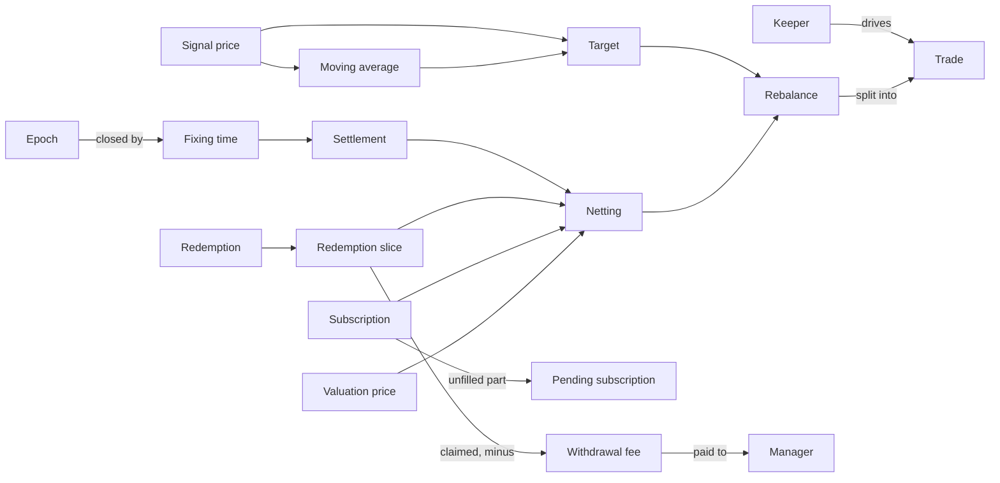

# Tide

A pooled fund on Solana that holds either cbBTC or USDC, switching once a day according to whether the signal price is above or below its 50-day moving average.

## How the terms relate

## Investors

**Subscription** (申购):
A user's request to put USDC into the fund in exchange for shares; it may be filled in parts, and each part becomes shares in proportion to the fund asset it actually adds (cbBTC bought or netted, or USDC when the target is USDC), counted once the fund's own rebalance is complete.
_Avoid_: Deposit, purchase, buy (ambiguous with the fund's own trades)

**Redemption** (赎回):
A user's request to turn shares back into USDC; the user receives what their redemption slice actually fetches, not a USDC amount fixed at the fixing time, and can claim only once that day's slice is fully sold.
_Avoid_: Withdrawal, sell

**Redemption slice** (赎回资产):
The redeemed shares' pro-rata portion of the fund's USDC and cbBTC at the fixing time, set aside for that day's redeemers and turned into USDC for them.

**Pending subscription** (待成交申购):
The part of a subscription's USDC not yet filled; it earns no shares and stays the user's until filled or cancelled. It is filled before newer subscriptions, counts toward the next epoch's subscription cap, and when the target is USDC it is filled without any trade.
_Avoid_: Unfilled deposit, carry-over

**Subscription cap** (申购上限):
The maximum USDC of subscriptions not yet bought (1M USDC): this epoch's queued subscriptions plus pending subscriptions carried in (and, between a fixing time and its fixing step, requests already queued for the next epoch). A request that would exceed it is rejected. Redemptions have no cap.

**Cancellation** (撤销):
Withdrawing a subscription or redemption before the fixing time that closes its epoch; after that, only a pending subscription can still be cancelled.

**Netting** (轧差):
Exchanging the cbBTC in the redemption slice for subscription USDC inside the fund at the valuation price, so only the difference trades on Jupiter.

## Fees

**Manager** (管理人):
The party that receives the withdrawal fee, paid to a fee address set when the fund is created and changeable only through the 48-hour timelock.
_Avoid_: Admin (the admin configures the fund; the manager is paid by it)

**Withdrawal fee** (取款费):
1% of the USDC a redeemer claims, paid to the manager; it is the only fee the manager earns.
_Avoid_: Performance fee, profit fee, carry

**Subscription fee** (申购费):
An optional charge on each subscription that stays in the fund.

**Subscription pause** (暂停申购):
The one action the admin may take immediately: stopping new subscriptions. Redemptions can never be paused, and the admin can never move fund assets.

## Settlement

**Settlement** (结算):
The daily process that records the signal at the fixing time, sets aside the redemption slice, nets it against subscriptions, then rebalances until every queued subscription and redemption is complete.

**Fixing time** (定价时刻):
01:00 UTC each day; the signal and netting use prices published then, whenever settlement actually runs.

**Keeper** (清算地址):
The designated address that alone may drive settlement during the keeper window.
_Avoid_: Crank, operator, admin

**Keeper window** (清算窗口):
The 30 minutes after the fixing time (01:00–01:30 UTC) when only the keeper may drive settlement; after it, anyone may, but under a tighter slippage bound than the keeper.

**Epoch** (期):
All subscriptions and redemptions submitted between two consecutive fixing times, numbered by the day of the fixing time that closes it; each is priced at that fixing time, so the queue never closes. If a fixing step is skipped, its epoch rolls into the next fixing, which then closes several epochs together. Each user has one ticket per epoch.
_Avoid_: Day, round, batch

## Trading

**Target** (目标持仓):
What the fund should hold after a settlement: all cbBTC when the signal price is above the moving average, all USDC otherwise.
_Avoid_: Position, regime, in-BTC

**Rebalance** (调仓):
The sequence of Jupiter trades in one settlement that first sells what is left of the redemption slices, then moves the fund's holdings to the target, then buys for pending subscriptions.
_Avoid_: Adjustment, buy/sell (ambiguous with subscription and redemption)

**Trade** (交易):
One Jupiter swap within a rebalance, bounded by the valuation price at the moment it executes and spaced at least a minimum interval after the previous trade.

**Trade cap** (单笔交易上限):
The maximum USDC notional of a single trade; a rebalance larger than the cap is split into several trades.
_Avoid_: Daily limit, max adjustment

## Prices

**Signal price** (信号价格):
The price used for the moving average and the hold-cbBTC-or-USDC signal: Pyth cbBTC/USD when that feed exists, otherwise BTC/USD. The `signal_feed` config says which, and changes only through the timelock.

**Moving average** (均线):
The average signal price over the last 50 fixing times, one per calendar day; a day with no settlement is backfilled with that day's published fixing price. A day never backfilled is skipped and an earlier day counts instead; prices are kept for 64 days, so with fewer than 50 prices in that span the target is USDC.

**Valuation price** (估值价格):
The price used for netting and to bound each trade's fill: the same feed as the signal price, so Pyth cbBTC/USD, or BTC/USD when there is no cbBTC/USD feed. The fund itself is never valued in USD.
_Avoid_: BTC price (when the cbBTC price is meant), NAV

**Depeg** (脱锚):
The Pyth cbBTC/USD price deviating from the BTC/USD price (the *reference price*) by more than a set threshold, checked before every trade and at netting; while it lasts the fund may sell cbBTC but not buy it. If the reference price is missing, stale or not from the fixing window, the peg cannot be confirmed and buys are blocked the same way. With no cbBTC/USD feed there is nothing to compare, so there is no depeg check.
