# tide

**A pooled Bitcoin fund on Solana: hold cbBTC when BTC is above its 50-day moving average, hold USDC when it is below.**

> **Devnet prototype. Do not use with real money.** The oracle and exchange are mocks. Mainnet needs a security audit and legal advice: pooling other people's money and charging a fee for managing it is regulated in many jurisdictions.

> **Design in transition.** This README shows the target design ([`CONTEXT.md`](CONTEXT.md) for terms, [`docs/adr/`](docs/adr/) for decisions). The code runs settlement as a fixing step plus capped trades. Redeemers are paid their slice's actual proceeds, and subscriptions become shares by the cbBTC they add. The config timelock, subscription pause, moving-average backfill, 1% withdrawal fee, subscription cap and pending cancels are built. The signal still uses BTC/USD. Sections marked *(current code)* describe what runs today.

---

## Why this rule

Backtest on Binance data, BTC, Mar 2018 – Sep 2026:

| Approach | Total return | Max drawdown |
|---|---|---|
| Buy and hold | +872% | −77% |
| 50-day MA filter | +2,719% | −58% |
| 100-day MA filter | +2,076% | −39% |
| 200-day MA filter | +1,083% | −64% |

- The filters cut drawdowns mainly by holding cash through the 2018 and 2022 bear markets.
- The best window changed between periods, so treat 50 days as a default, not an optimum.
- Short-term altcoin strategies lost money in the same study, so the fund holds only BTC.
- Past results do not predict future returns.

---

## How it works

### One day

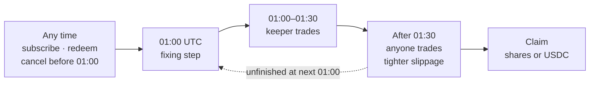

### Fixing step (01:00 UTC)

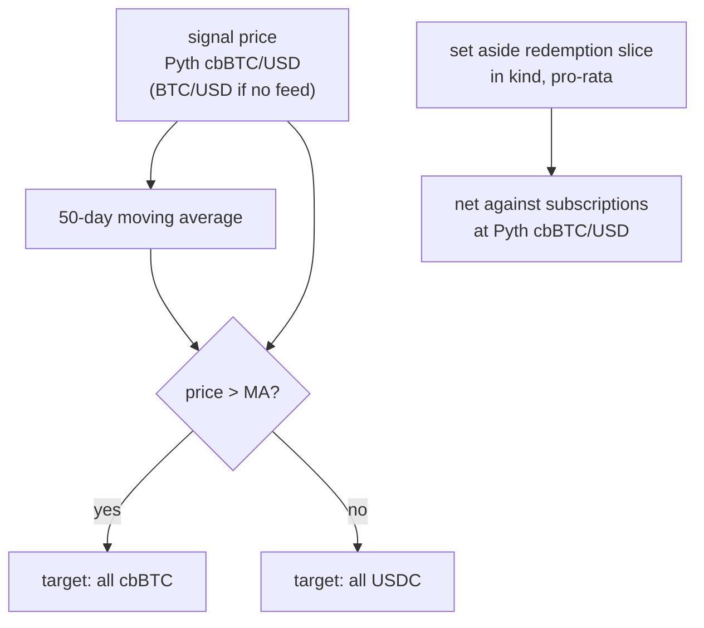

### Where the money goes

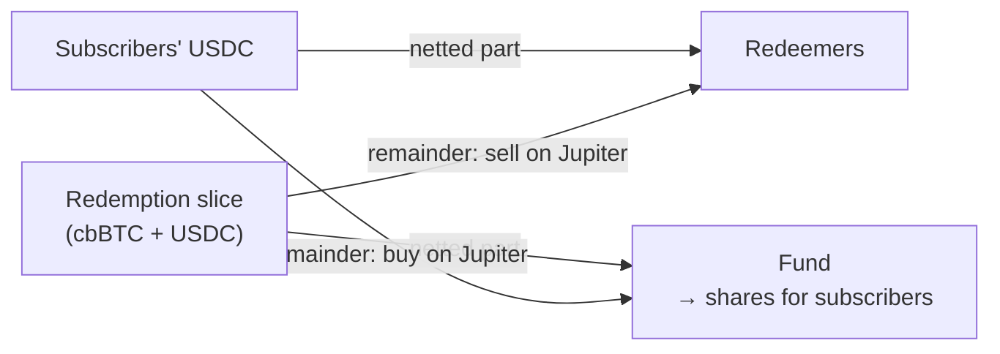

Netting uses the valuation price. Only the difference trades on Jupiter, and each side pays for its own trades ([ADR 0002](docs/adr/0002-flows-pay-their-own-execution.md)).

### Trade order

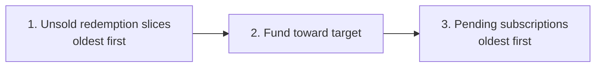

### Every trade

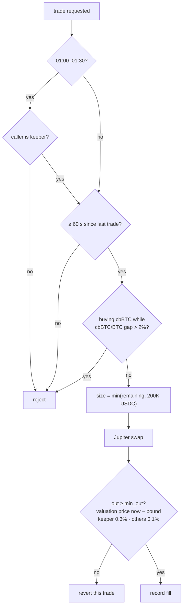

See [ADR 0001](docs/adr/0001-multi-step-settlement.md).

### Subscription

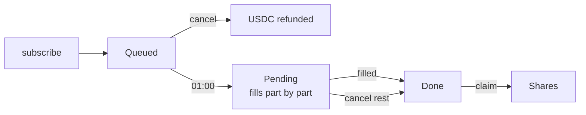

| Step | Rule |
|---|---|
| subscribe | At most 1M USDC per epoch, including pending |
| cancel | Until 01:00 |
| partial fill | Filled part becomes shares by the cbBTC it adds, after the fund's rebalance ([ADR 0006](docs/adr/0006-shares-counted-in-fund-asset.md)) |
| filled | Fully bought, or target is USDC (no trade needed) |
| cancel rest | Any time; unfilled USDC refunded, no shares for it |

### Redemption

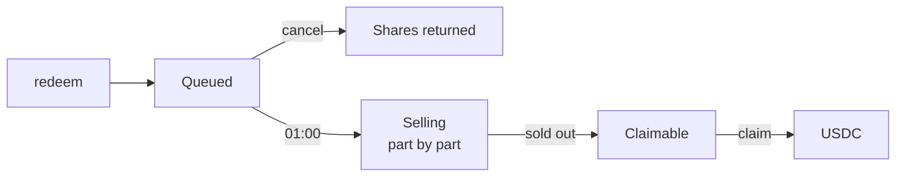

| Step | Rule |
|---|---|
| redeem | No cap, can never be paused |
| cancel | Until 01:00 |
| 01:00 | Pro-rata redemption slice set aside |
| sell part | Netting first, then Jupiter, oldest slices first |
| claim | Actual USDC proceeds, only after the whole slice is sold |

### Prices

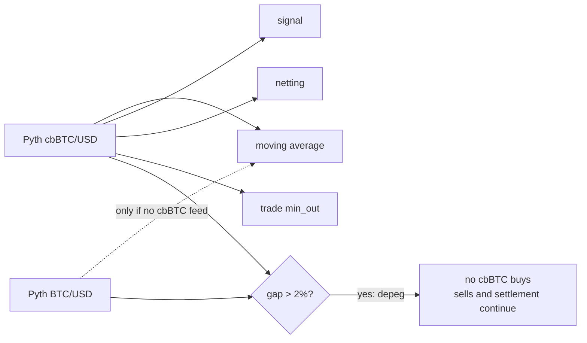

The signal and netting use prices published in `[01:00, 01:01)` UTC. A missed day is backfilled with that day's Pyth price. The fund is never valued in USD ([ADR 0005](docs/adr/0005-signal-from-cbbtc-price.md), [ADR 0003](docs/adr/0003-btc-signal-cbbtc-valuation.md)).

### Withdrawal fee

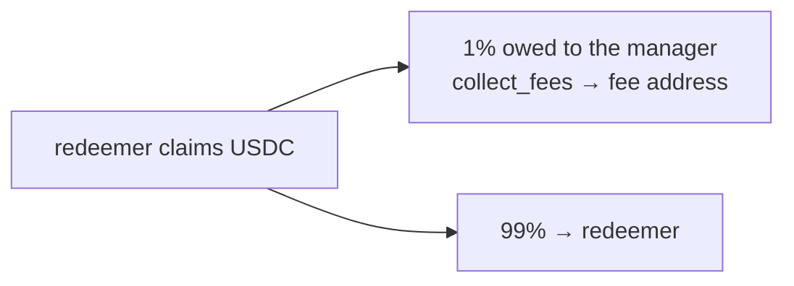

There is no performance fee. Redeemers pay the 1% on losses too ([ADR 0007](docs/adr/0007-withdrawal-fee-replaces-performance-fee.md)).

### Governance

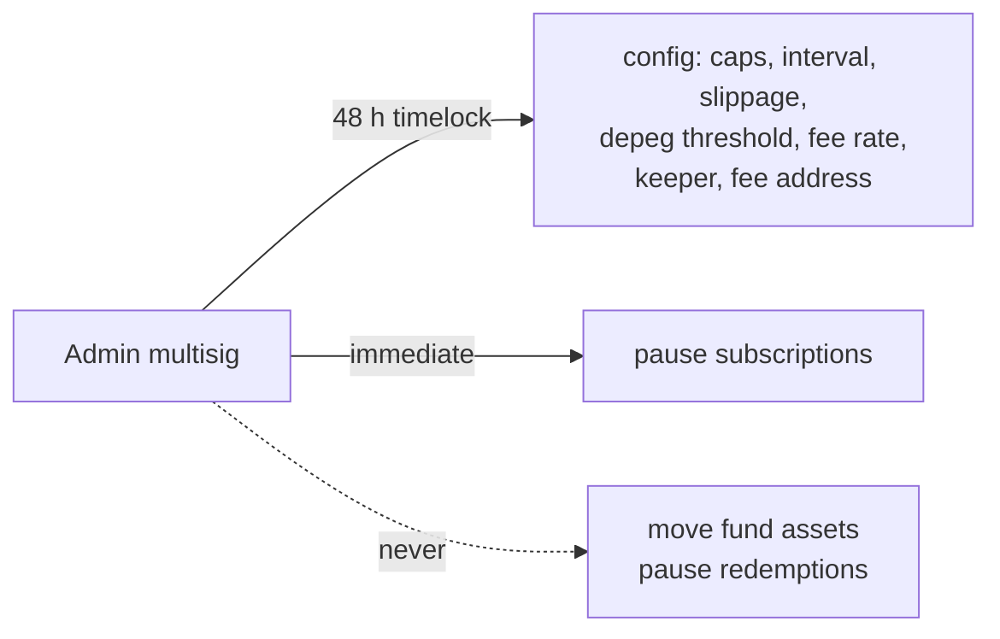

### Other guarantees

| Guarantee | How |
|---|---|
| Donations can't move the share price | Shares come from internal records, not token balances |
| No rounding dust | The last claimant of an epoch gets the exact remainder |
| Settlement never gets stuck | Unfinished work carries into the next settlement; a depeg only blocks buys |

---

## Repository layout

```
tide/
├── fund-logic/          Pure-Rust accounting + unit tests
├── programs/tide/       Anchor program: accounts and token transfers
├── tests/tide.ts        End-to-end test (bankrun, time travel)
├── scripts/crank.ts     Daily settlement script (devnet)
├── docs/adr/            Architecture decisions
├── docs/agents/         Agent skill configuration
├── CONTEXT.md           Domain vocabulary
└── AGENTS.md            Rules for agents and contributors
```

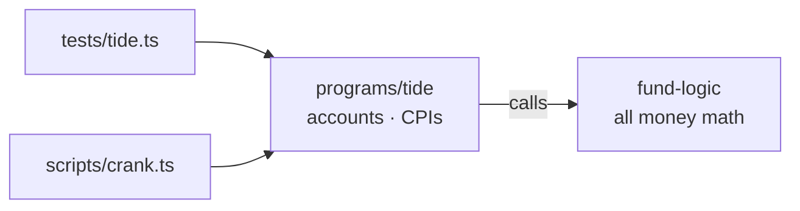

---

## Getting started *(current code)*

Needs Rust (stable), Solana CLI 2.x, Anchor 0.31.1 (via `avm`), Node.js 20+ and Yarn.

```bash
cd fund-logic && cargo test && cd ..   # logic tests, no Solana toolchain
anchor keys sync                       # write program ID
anchor build
yarn install && anchor test            # end-to-end
```

> The Anchor program has never been compiled in the original author's environment. If `anchor build` fails, the cause is most likely a small API mismatch in the wrapper, not in the accounting.

### Deploy to devnet

```bash
solana config set --url devnet && solana airdrop 2
anchor deploy --provider.cluster devnet
```

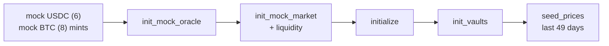

Run the crank daily at 01:00 UTC. The mock price must be posted within 60 s:

```cron
0 1 * * * cd /path/to/tide && ANCHOR_PROVIDER_URL=https://api.devnet.solana.com ANCHOR_WALLET=$HOME/.config/solana/id.json yarn ts-node scripts/crank.ts >> crank.log 2>&1
```

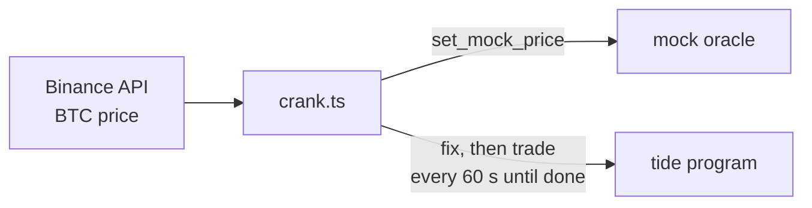

---

## Program reference *(current code)*

| Instruction | Who | Purpose |
|---|---|---|
| `initialize(config)` | admin | Create fund account and share mint |
| `init_vaults` | admin | Create the five fund-owned token accounts |
| `seed_prices(prices)` | admin | Pre-load the signal prices of the days ending yesterday, before the first settlement only |
| `request_subscription(amount, epoch)` | anyone | Queue a subscription; `epoch` is the day of the next fixing time, used for the ticket address |
| `request_redemption(shares, epoch)` | holder | Queue a redemption; `epoch` as above |
| `cancel` | ticket owner | Withdraw a queued ticket in full, until the fixing time that closes its epoch |
| `cancel_pending` | ticket owner | Any time after the fixing: refund the unfilled part of a subscription and take the shares already filled |
| `fix(epoch)` | keeper in 01:00–01:30, then anyone | Fixing step, once a day after `settle_offset_secs`; `epoch` is today's day number |
| `trade` | keeper in 01:00–01:30, then anyone | One capped trade; others in the window get `KeeperOnly`; answers `NothingToTrade`, `TradeTooSoon`, `DepegBlocksBuy` or `FixPending` when there is none |
| `claim` | subscriber / redeemer | Collect filled shares (repeatable) or redemption USDC; pass the record of the fixing that closed the ticket's epoch |
| `collect_fees` | anyone | Pay the withdrawal fees owed to the manager to the fee address; claims never depend on that account |
| `backfill_price(day)` | anyone | Record a missed day's signal price, published in that day's fixing window |
| `propose_config(config)`, `apply_config` | admin | Config change, applied 48 h after the proposal |
| `pause_subscriptions`, `resume_subscriptions` | admin | Immediate; redemptions are never paused |
| `init_mock_oracle`, `set_mock_price`, `init_mock_market`, `set_mock_market_fee` | admin | Devnet only |

### Configuration

| Field | Default | Meaning | |
|---|---|---|---|
| `window` | 50 | Moving-average days (max 64) | current |
| `settle_offset_secs` | 3600 | Fixing time after 00:00 UTC | current |
| `max_slippage_bps` | 30 | Keeper slippage bound | current |
| `subscription_fee_bps` | 0 | Subscription fee, kept in fund | current |
| `min_subscription` | 1 USDC | Minimum subscription | current |
| `max_staleness_secs` | 600 | Max oracle price age | current |
| `depeg_threshold_bps` | 200 | cbBTC vs BTC gap that stops buys | current |
| `trade_cap_usdc` | 200,000 USDC | Max notional per trade | current |
| `min_trade_interval_secs` | 60 | Seconds between trades | current |
| `public_slippage_bps` | 10 | Non-keeper callers after the window (≤ `max_slippage_bps`) | current |
| `keeper_window_secs` | 1800 | Keeper-only time after the fixing time | current |
| `subscription_cap_usdc` | 1,000,000 USDC | Max subscription USDC not yet bought: queued plus pending; a request that would exceed it is rejected; redemptions are uncapped | current |
| `withdrawal_fee_bps` | 100 (max 100) | Of each redemption claim, rounded down, owed to the manager; share claims and refunds pay none | current |
| `keeper` | set at creation | Keeper address; change via 48 h timelock | current |
| Config timelock | 48 h, fixed in code | `propose_config` a whole config, `apply_config` after 48 h; a new proposal restarts the clock. `window` and `settle_offset_secs` are set at creation and cannot change | current |
| Subscription pause | off | `pause_subscriptions` / `resume_subscriptions`, immediate, admin only; redemptions can never be paused | current |
| `fee_address` | set at creation | Manager's wallet; `collect_fees` pays the owed fees to its USDC associated token account. Change via 48 h timelock | current |

### Accounts (PDAs)

| Account | Seeds |
|---|---|
| Fund | `["fund", admin]` |
| Share mint | `["share_mint", fund]` |
| USDC vault / BTC vault | `["usdc_vault", fund]` / `["btc_vault", fund]` |
| Subscription escrow / Share escrow / Payout vault | `["subscription_escrow", fund]` / `["share_escrow", fund]` / `["payout_vault", fund]` |
| Ticket (per user per epoch) | `["ticket", fund, user, epoch as u64 LE]` |
| Epoch record | `["epoch", fund, epoch as u64 LE]` (epoch = fixing day, unix / 86400) |
| Mock oracle / Mock market | `["oracle", authority]` / `["market", authority]` |
| Market vaults | `["market_usdc", market]` / `["market_btc", market]` |

### Units

| Quantity | Unit |
|---|---|
| USDC | 6 decimals |
| cbBTC | 8 decimals |
| Shares | 6 decimals; first share = 1 USDC |
| Price | micro-USD per 1 BTC |

---

## Trade execution

| Technique | Purpose | Status |
|---|---|---|
| Oracle-based `min_out` | Reject bad fills and sandwiches | Implemented (per trade in target design) |
| Capped, spaced trades | Reduce price impact | Designed, ADR 0001 |
| Flows pay their own execution | Holders who stay don't pay for others | Designed, ADR 0002 |
| Keeper window + tighter public bound | Limit what third-party callers can extract | Designed |
| Randomized execution time | Harder to anticipate | Optional |
| MEV-protected submission (Jito) | Avoid public mempool | Mainnet |
| Limit orders (Jupiter) | Price control | Mainnet |

---

## Roadmap to mainnet

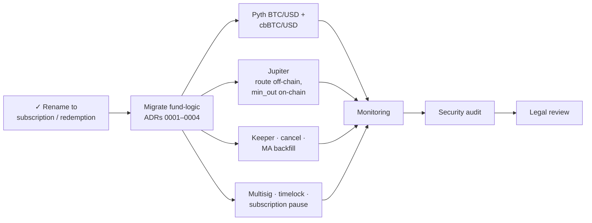

### Known limitations

- A day without `fix` leaves a gap until someone backfills it. A day never backfilled is skipped, and the average uses an earlier day instead. Prices are stored for 64 days, so if fewer than 50 of the last 64 days have a price, the fund holds USDC.
- cbBTC carries custodian risk. The depeg rule stops new buys but cannot recover lost value.
- Redemptions pay out only after the slice is fully sold, which can take more than a day in thin liquidity or a depeg.

---

## Disclaimer

Experimental prototype for educational purposes. Not investment advice, not audited, may contain bugs that lose all funds. Backtest results do not guarantee future performance.
