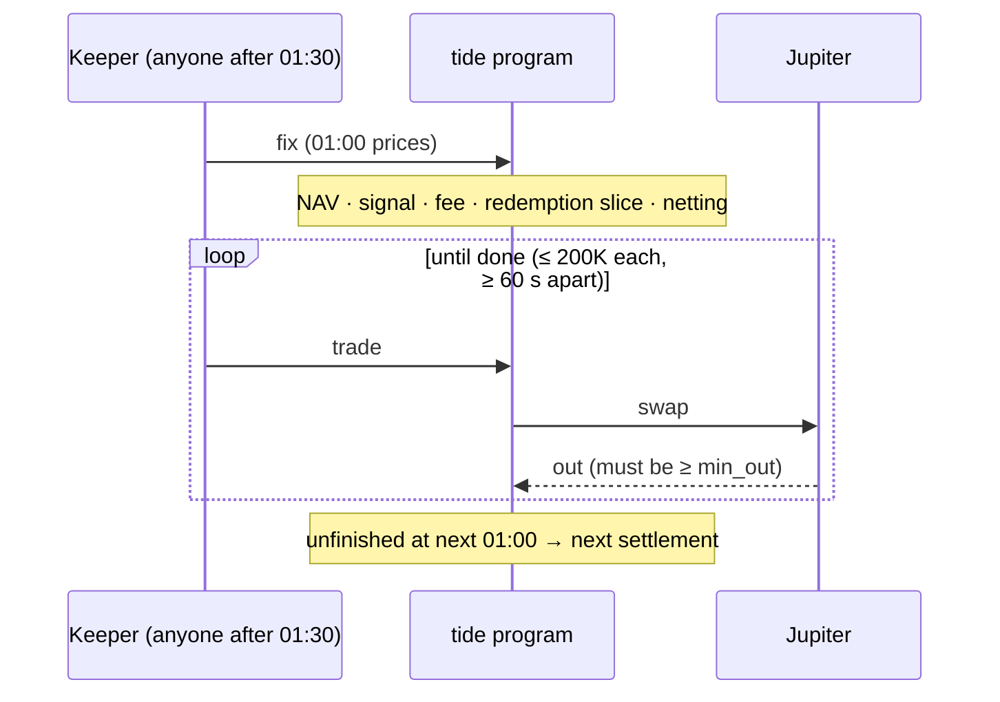

# Settlement is a multi-step process of capped trades

Swapping the whole fund at once costs too much in price impact. Settlement is therefore one fixing step followed by trades of at most 200K USDC, spaced at least 60 s apart. Each step is atomic on its own; work left at the next fixing carries over, so settlement never gets stuck.

## Considered Options

| Option | Rejected because |
|---|---|
| One atomic swap per day (original) | Heavy price impact; a swap beyond the slippage bound fails every day |
| Daily cap with gated redemptions | Requests should complete the same day when liquidity allows |
