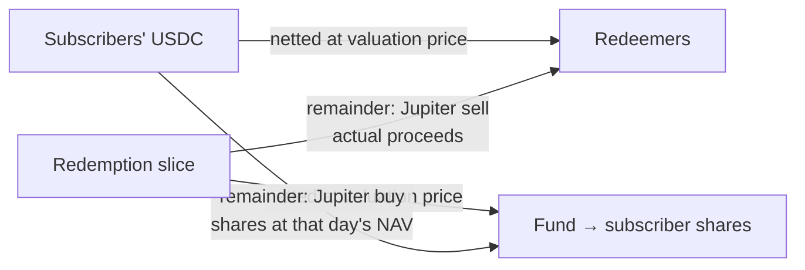

> Status: amended by ADR 0006. Subscription parts become shares by the asset they add, not at that day's NAV.

# Subscriptions and redemptions are filled at real execution prices

Settlement trades over minutes or hours. Filling everyone at the 01:00 NAV would push that day's price moves and trading costs onto holders who stay. Instead, each side pays for its own trades. This replaces "fill at the NAV before the swap".

## Consequences

| Who | Effect |
|---|---|
| Redeemers | Claim only after the whole slice is sold |
| Subscribers | Get shares part by part; can cancel the pending part any time |
| All | Subscription and redemption fees default to 0 |
