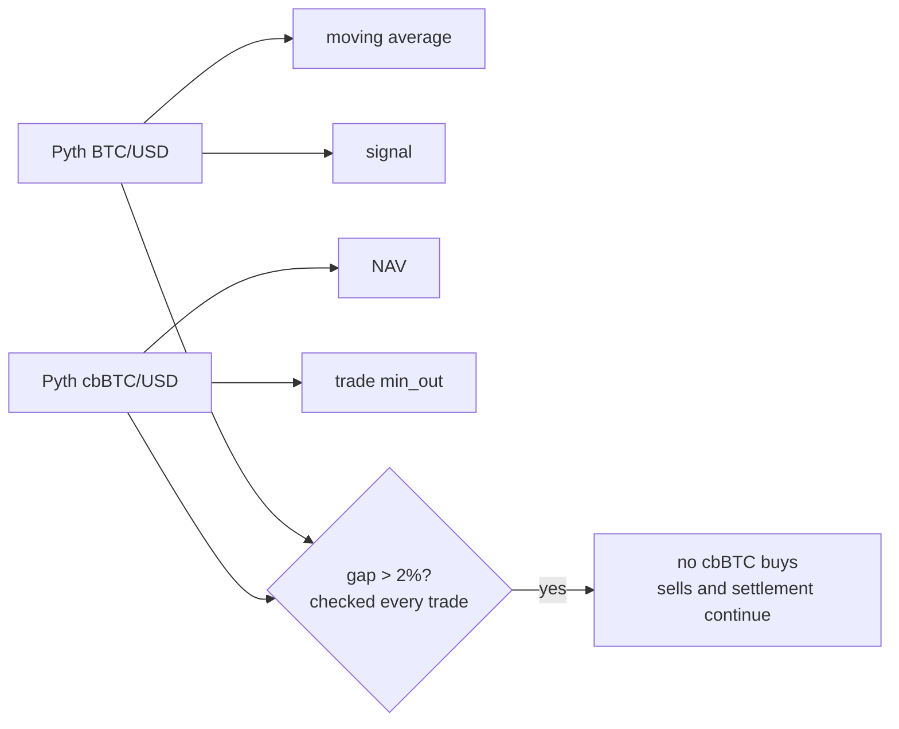

> Status: signal part superseded by ADR 0005. The depeg rule still holds.

# Signal from BTC/USD, valuation from cbBTC/USD

The strategy follows BTC, but the fund holds cbBTC, which can depeg. Valuing at BTC/USD during a depeg would overpay redeemers at the expense of holders who stay.

Settlement keeps running during a depeg, so a lasting depeg cannot lock the fund.
