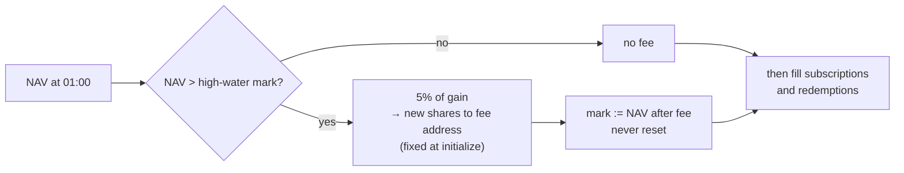

# Manager performance fee on a fund-level high-water mark

The manager earns 5% (capped at 20% in code) of NAV gains above a high-water mark. This is the one deliberate exception to "the admin can never take user funds".

## Considered Options

| Option | Rejected because |
|---|---|
| Per-user cost basis, charged at redemption | Needs non-transferable shares and per-user accounting |
| Fee kept in the fund | The fee is the manager's compensation |
