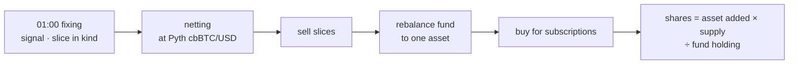

# Shares are counted in the fund's asset at execution, not by a USD NAV

Every fill should follow actual execution, so the fund is never valued in USD. After each rebalance the fund holds a single asset: cbBTC above the moving average, USDC below. That USDC is waiting to buy, and every other USDC is waiting to be bought with or claimed. A subscription's shares are the fund asset it actually adds (cbBTC bought or netted, or its USDC when the target is USDC) × share supply ÷ the fund's holding of that asset. They are counted only after the fund's own rebalance for that settlement is complete, because a mixed holding cannot be compared by amount. This amends ADR 0002, which priced subscription parts at that day's NAV.

## Consequences

| Topic | Effect |
|---|---|
| Requests | Submitted before 01:00 join that day's settlement; later ones join the next |
| Redemption slice | Set aside in kind and pro-rata at the fixing time; no price needed |
| Netting | The one fund-internal exchange; uses the Pyth cbBTC/USD fixing price |
| Trade order | Slices, then the fund's rebalance, then subscription buys |
| Subscribers | Get shares only after the fund's rebalance finishes; a rebalance that runs past the next fixing delays them |

## Considered Options

| Option | Rejected because |
|---|---|
| NAV in USD at the fixing price (ADR 0002 as written) | Values the fund with an oracle price instead of actual execution |
| Skip netting, trade every flow on Jupiter | Higher costs; netting at the Pyth price was preferred |
