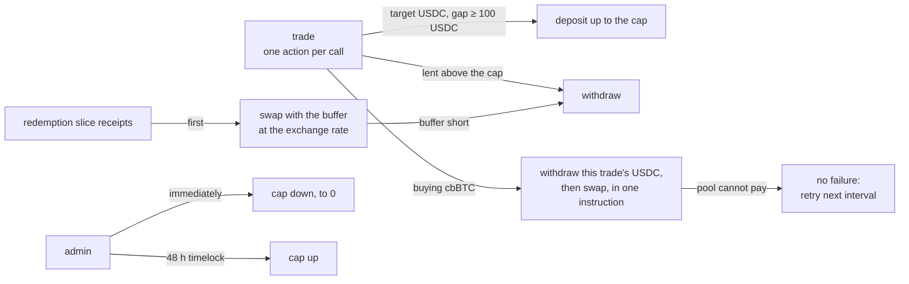

# Idle USDC is lent out, within a cap, without ever blocking settlement

The fund holds USDC about half the time, earning nothing. While the target is USDC, the fund lends its own USDC to a lending pool, up to a lending cap (default 80% of its USDC). The rest stays in the vault as a buffer. The pool returns lending receipts, counted as a third fund asset at the pool's exchange rate, rounded down. All interest goes to the fund; the manager still earns only the withdrawal fee (ADR 0007). This amends ADR 0006: when the target is USDC, "the fund's holding of USDC" is the vault USDC plus the lent value.

## Rules

| Topic | Decision |
|---|---|
| What is lent | Only the fund's own USDC, only while the target is USDC. Pending subscriptions, redemption payouts and fees owed are never lent |
| Where | Inside `trade`; deposits and withdrawals are not market trades, so the trade cap, interval, slippage and depeg checks do not apply to them |
| Switching to cbBTC | Each capped buy withdraws only what it spends; the rest keeps earning |
| Redemption slice | Takes its pro-rata share of USDC, receipts and cbBTC in kind; its receipts are swapped with the buffer first, then withdrawn |
| Pool cannot pay | The step waits and retries; the fund keeps holding USDC (still earning). Settlement never fails permanently |
| Losses | A drop in the exchange rate is shared pro-rata by all shares |
| Emergency | The admin may lower the cap at once, down to 0; raising it goes through the timelock. This is the second immediate admin action, after pausing subscriptions |
| Backtest | Excludes interest: historical rates are not reliable enough to backtest |

## Considered Options

| Option | Rejected because |
|---|---|
| Separate `lend` / `unlend` instructions | A withdrawal could land without its swap, leaving an in-between state |
| Withdraw everything when switching to cbBTC | Loses interest during a multi-trade rebalance, and one failed withdrawal stalls the whole switch |
| Pick a mainnet protocol now (Kamino, marginfi) | The project is devnet-only; a mock pool can simulate illiquidity and losses, which a devnet protocol cannot |

## Consequences

- Devnet uses a mock lending pool (admin-set rate, withdrawable limit, loss haircut), excluded from mainnet builds like the mock market.
- The fund account layout changes, so the devnet fund is rebuilt rather than migrated.
